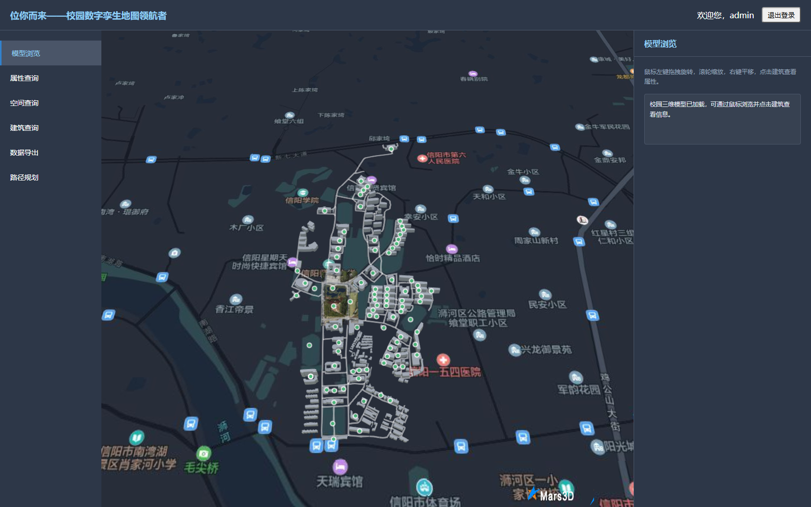
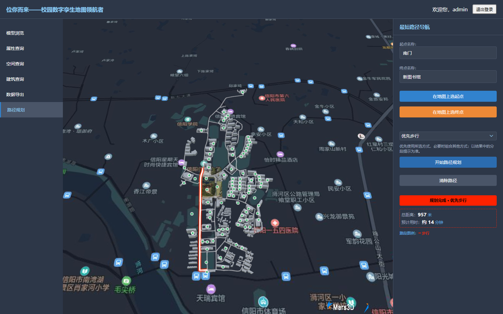

# 位你而来——校园数字孪生地图领航者

基于 Mars3D 和 Cesium 的校园三维地图演示项目。网站由 HTML、CSS 和 JavaScript 组成，通过相对路径加载校园道路、建筑白模与倾斜摄影数据，可在静态网页托管服务运行，无须后端应用或数据库。

在线演示：[进入校园地图](https://lchangli.github.io/campus-digital-twin-map/)

演示账号：`admin`，密码：`123456`。

## 界面预览

校园三维模型与道路：



南门到新图书馆的步行路线：



## 现有功能

- 三维模型浏览：展示建筑白模、倾斜摄影和校园道路，支持旋转、缩放及点击建筑查看信息。
- 属性查询：按建筑名称关键词查找校园地物并定位。
- 空间查询：根据当前视角位置和输入半径查找附近地物。
- 建筑查询：使用预设关键词、建筑名称与别名查找相关信息。
- 路径规划：输入地点名称或在地图上选取起终点，选择优先步行、电动车或驾车，使用路网与 Dijkstra 算法计算并展示路径。算法对非首选方式增加权重，必要时可能使用其他方式的路段，结果会显示实际使用的方式。
- 数据导出：导出建筑属性 JSON 或 CSV 文件（界面中的“Excel”导出实际为 CSV）。
- 页面适配：提供桌面布局和移动端抽屉菜单。

## 技术与目录

- HTML / CSS / 原生 JavaScript
- 路径搜索：Dijkstra + 二叉最小堆，按通行方式权重选择路线
- Mars3D 3.11.8 / mars3d-cesium 1.145.0：三维地图与模型渲染，运行文件随站点保存于 `vendor/`
- GeoJSON：道路数据
- 3D Tiles / GLB：三维模型数据

```text
.
├── index.html       # 登录入口
├── dashboard.html   # 地图页面及样式、依赖引用
├── script.js        # 地图、查询、路径绘制和导出逻辑
├── routing.js       # 独立的路径搜索算法
├── tests/           # 路径算法回归测试
├── docs/screenshots/ # 实际运行截图
├── road/            # road.geojson 校园道路
├── model/           # 建筑白模 tileset.json 与 GLB 等模型文件
├── Data/            # 倾斜摄影 tileset.json 与分块模型文件
├── vendor/          # 固定版本的 Mars3D / Cesium 运行文件
├── .nojekyll        # 让 GitHub Pages 直接提供静态文件
└── README.md
```

请保留目录名称及大小写。模型入口 JSON 和各层级引用的模型文件需要完整保留，仅上传 HTML 与 JavaScript 无法展示完整校园模型。

## 演示登录

- 用户名：`admin`
- 密码：`123456`

这是前端演示登录，账号判断和登录状态都在浏览器内完成，使用 `localStorage` 保存状态；它不提供服务端身份认证，也不能保护静态目录中的文件。

## 本地运行

安装 Python 3 后，在项目根目录打开终端运行：

```powershell
python -m http.server 8765 --bind 127.0.0.1
```

浏览器访问 `http://127.0.0.1:8765/index.html`，使用演示账号登录。终端中按 `Ctrl+C` 可停止服务。

请通过 HTTP 服务访问。直接双击 HTML 使用 `file://` 打开时，浏览器会限制 JavaScript 请求本地 GeoJSON、3D Tiles 等资源。

## GitHub Pages 部署

1. 将本目录的完整内容提交到 GitHub 仓库，使 `index.html` 位于仓库根目录。
2. 在仓库的 **Settings → Pages → Build and deployment** 中选择 **Deploy from a branch**。
3. 分支选择 `main`，目录选择 `/ (root)`，保存并等待发布完成。
4. 使用 GitHub Pages 页面显示的实际网址访问，检查登录、底图、模型、查询与路径规划。

发布时需包含 `road/`、`model/` 和 `Data/` 的完整运行数据。本项目没有构建步骤。

## 更新与验证

在本地修改代码后，先通过上面的 HTTP 服务检查登录、模型、查询和路径规划。安装 Node.js 后，可运行路径算法回归测试：

```powershell
node --test tests/routing.test.cjs
```

确认无误后，将变更提交并推送到仓库的 `main` 分支；GitHub Pages 会自动重新发布，无须重新上传全部模型数据。可在仓库的 **Actions** 中查看发布结果，完成后刷新在线页面。更新第三方运行库时需同步检查对应版本、资源目录和许可文件。

## 运行条件与说明

- 浏览器需支持 WebGL；三维模型的首次加载时间取决于网络和设备性能。
- Mars3D / Cesium 的运行文件随站点一起提供，不从 CDN 自动更新。腾讯、高德底图仍依赖第三方网络服务，服务不可用时会影响底图展示。
- 第三方运行库的版本、来源和许可文件见 [vendor/THIRD_PARTY_NOTICES.md](vendor/THIRD_PARTY_NOTICES.md)。
- 源码不保存个人 Cesium ion token；目前的本地模型与第三方底图不使用个人 ion 资源。
- 地物目录中的理科楼、理科楼南楼和理科北楼目前共用坐标，需依据可靠数据进一步核实；演示路线不应作为实地精确导航依据。
- 当前仓库包含校园空间数据。公开发布前应核实相应数据的使用与公开权限；本说明不代表原数据提供方授予公开许可。
